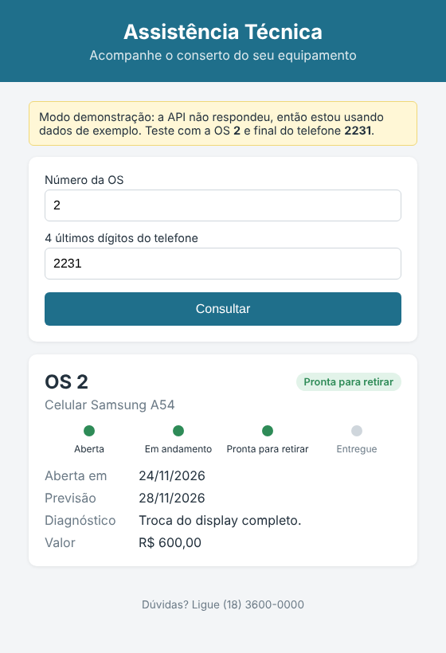

# Ordem de Serviço

Controle de ordens de serviço para uma assistência técnica pequena (notebook, celular, impressora...). O balcão abre a OS no sistema desktop, o técnico registra o diagnóstico e o valor, e o cliente acompanha o andamento por uma página web informando o número da OS.

É um projeto menor que o [agro-erp](https://github.com/phx90/agro-erp), feito pra praticar o mesmo conjunto: Delphi na tela, regra de negócio em PL/SQL no Oracle e uma parte web simples.



## Como funciona

A OS passa por estes status:

```
ABERTA -> EM_ANDAMENTO -> PRONTA -> ENTREGUE
   \           /
    CANCELADA
```

- Só cliente ativo pode abrir OS, e equipamento e defeito são obrigatórios.
- Para iniciar é preciso escolher o técnico.
- Só dá pra concluir depois de registrar o diagnóstico com o valor da mão de obra e das peças.
- Só entrega o que está PRONTA.
- Cancelar só antes de ficar pronta, e precisa informar o motivo.
- Toda troca de status vai pra tabela `os_historico`.

Essas regras estão na package `pkg_os`. O Delphi só chama as procedures e mostra a mensagem de erro que volta do banco.

## Estrutura

```
database/          scripts do Oracle (rodar o instalar.sql)
database/testes/   testes da pkg_os
desktop/           projeto Delphi (VCL + FireDAC)
web/               página de consulta (HTML, CSS e JavaScript)
```

## Rodando

### Banco

Oracle 19c ou mais novo. Usei o Oracle Free no Docker:

```bash
docker run -d --name oracle -p 1521:1521 \
  -e ORACLE_PASSWORD=oracle \
  -e APP_USER=os -e APP_USER_PASSWORD=os \
  gvenzl/oracle-free:23-slim-faststart
```

Depois que aparecer `DATABASE IS READY TO USE!` no log:

```bash
cd database
sql os/os@localhost:1521/FREEPDB1 @instalar.sql
```

Pode ser SQLcl, SQL*Plus ou o SQL Developer (abrindo os arquivos na ordem). Já vem com alguns clientes e OS de exemplo.

### Testes

```bash
cd database
sql os/os@localhost:1521/FREEPDB1 @testes/testar_pkg_os.sql
```

O script passa pelos cenários principais (fluxo completo, transições proibidas, campos obrigatórios) e desfaz tudo no final. A saída é algo assim:

```
pkg_os
  ok     abre a OS como ABERTA
  ok     iniciar passa para EM_ANDAMENTO
  ...
19 passaram, 0 falharam
```

Não usei utPLSQL aqui pra não ter que instalar nada além do banco.

### Desktop

- Delphi 11 ou 12 com FireDAC e o driver Oracle (edição Enterprise/Architect ou a trial).
- Oracle Instant Client na máquina, com a mesma arquitetura do executável (32 ou 64 bits).

Copie o `desktop/config.ini.exemplo` para a pasta do executável como `config.ini`, ajuste a conexão e rode o `OrdemServico.dpr`.

Telas:
- **Principal**: lista de OS com filtro por status e busca por cliente ou equipamento. Os botões de ação habilitam conforme o status da OS selecionada.
- **Nova OS**: cliente, equipamento, número de série, defeito e previsão.
- **Diagnóstico**: texto do diagnóstico e valores.
- **Clientes**: cadastro simples (nome, telefone e e-mail).

### Web

Abrindo o `web/index.html` direto no navegador já funciona em modo demonstração, com dados fixos. Teste com a OS 2 e final de telefone 2231.

Pra consultar o banco de verdade precisa do [ORDS](https://www.oracle.com/database/technologies/appdev/rest.html). Com ele no ar, rode o `database/04_api_ords.sql` e confira o endereço em `web/js/config.js`.

O cliente informa o número da OS e os 4 últimos dígitos do telefone cadastrado. Assim ninguém vê a OS de outra pessoa só trocando o número.

## Algumas escolhas

- Erros de negócio usam `raise_application_error` com códigos de -20001 a -20006, e o Delphi tira o "ORA-200xx:" da frente antes de mostrar.
- A OS fica travada com `select ... for update` durante a troca de status, pra duas telas não mudarem a mesma OS ao mesmo tempo.
- Sem `else` no código: as funções saem cedo quando alguma condição não é atendida (guard clause).
- Cliente não é apagado, só inativado, porque pode ter OS ligada a ele.

## Pendências

- [ ] Impressão da OS (comprovante pro cliente)
- [ ] Relatório de faturamento por técnico
- [ ] Aviso por WhatsApp quando a OS ficar pronta
