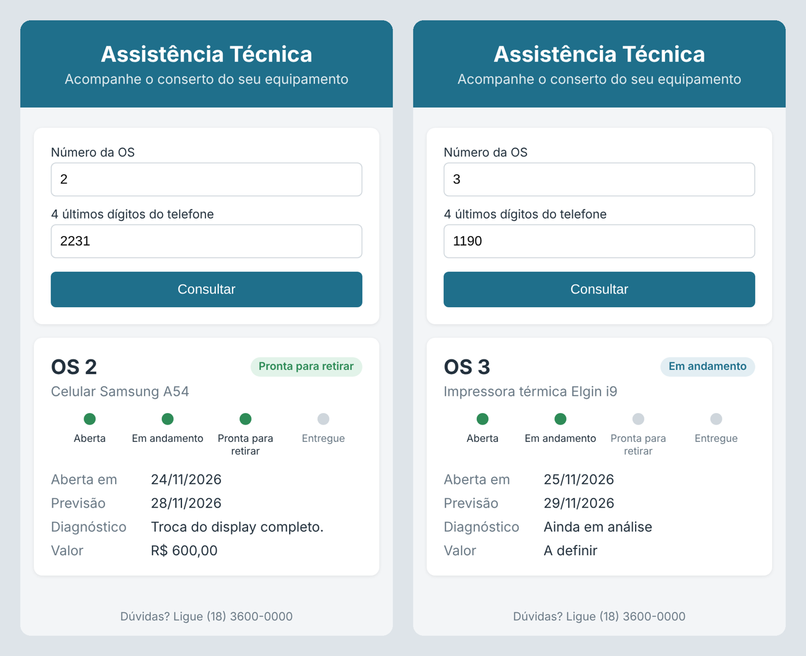
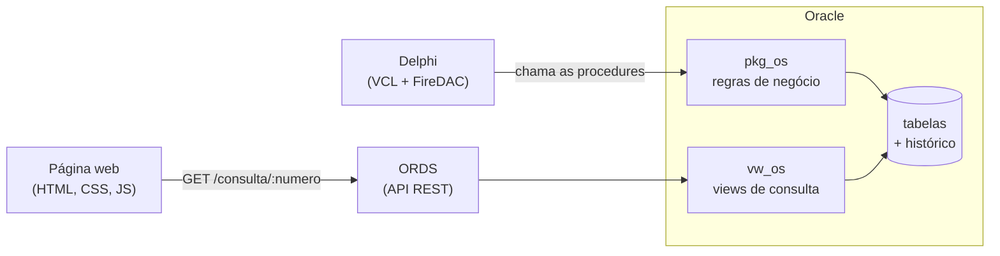
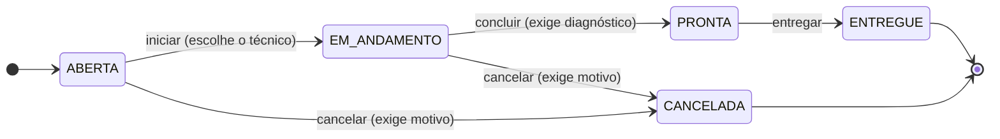

<h1 align="center">Ordem de Serviço</h1>

<p align="center">
  Controle de ordens de serviço para assistência técnica, com regras de negócio em <b>Oracle PL/SQL</b>,
  sistema desktop em <b>Delphi</b> e consulta web para o cliente.
</p>

<p align="center">
  
  
  
  
  
  
</p>

<p align="center">
  <a href="https://phx90.github.io/ordem-servico/"><b>Ver a consulta online</b></a>
  ·
  <a href="#como-rodar">Como rodar</a>
  ·
  <a href="#regras-de-negócio">Regras de negócio</a>
</p>

<p align="center">
  
</p>

## Sobre

Numa assistência técnica o fluxo é sempre parecido: o cliente deixa o equipamento no balcão, um técnico avalia, passa o orçamento, faz o conserto e o cliente volta pra buscar. No meio disso o cliente liga várias vezes perguntando se já ficou pronto.

Este projeto cobre esse ciclo:

- **No balcão (Delphi):** cadastro do cliente, abertura da OS, escolha do técnico, diagnóstico com valores, conclusão e entrega.
- **No banco (Oracle):** todas as regras ficam numa package PL/SQL, e cada mudança de status fica gravada num histórico.
- **Para o cliente (web):** uma página onde ele consulta a própria OS pelo número e pelos 4 últimos dígitos do telefone.

É o meu segundo projeto com essa stack. O primeiro, maior, é o [agro-erp](https://github.com/phx90/agro-erp).

## Arquitetura



O Delphi não escreve direto nas tabelas da OS: ele chama a `pkg_os`, e é ela que valida e grava. Assim a regra é a mesma para qualquer tela ou integração que venha depois.

## Regras de negócio



| Regra | Onde |
|---|---|
| Só cliente ativo pode abrir OS. Equipamento e defeito são obrigatórios. | `pkg_os.abrir` |
| A previsão de entrega não pode ser uma data que já passou. | `pkg_os.abrir` |
| Para iniciar é preciso um técnico ativo. | `pkg_os.iniciar` |
| Mão de obra e peças não podem ter valor negativo. | `pkg_os.registrar_diagnostico` |
| Só conclui a OS que já tem diagnóstico. | `pkg_os.concluir` |
| Só entrega o que está PRONTA. | `pkg_os.entregar` |
| Depois de pronta, a OS não pode mais ser cancelada. | `pkg_os.cancelar` |
| Toda troca de status é gravada em `os_historico`. | `mudar_status` (privada) |

Os erros de negócio usam `raise_application_error` (-20001 a -20006). O Delphi tira o prefixo `ORA-200xx:` e mostra só a mensagem para o usuário.

## Stack

| Camada | Tecnologia |
|---|---|
| Banco | Oracle 19c+ (testado no Oracle Free 23ai), PL/SQL |
| Desktop | Delphi 11/12, VCL, FireDAC (driver Oracle) |
| API | Oracle REST Data Services (ORDS) |
| Web | HTML, CSS e JavaScript puro, sem framework |

## Estrutura

```
database/
  01_tabelas.sql        clientes, técnicos, ordens_servico, os_historico
  02_pkg_os.sql         package com as regras
  03_views.sql          vw_os e vw_os_atrasadas
  04_api_ords.sql       endpoint REST da consulta
  05_dados_exemplo.sql
  instalar.sql          roda tudo na ordem
  testes/               testes da pkg_os
desktop/
  OrdemServico.dpr
  src/                  formulários, service e repositório
web/                    página de consulta
```

## Como rodar

### 1. Banco

Precisa de um Oracle 19c ou mais novo. Pelo Docker é rápido:

```bash
docker run -d --name oracle -p 1521:1521 \
  -e ORACLE_PASSWORD=oracle \
  -e APP_USER=os -e APP_USER_PASSWORD=os \
  gvenzl/oracle-free:23-slim-faststart
```

Quando o log mostrar `DATABASE IS READY TO USE!`:

```bash
cd database
sql os/os@localhost:1521/FREEPDB1 @instalar.sql
```

Funciona com SQLcl, SQL*Plus ou SQL Developer. O script já cria alguns clientes, técnicos e OS de exemplo.

### 2. Testes

```bash
sql os/os@localhost:1521/FREEPDB1 @testes/testar_pkg_os.sql
```

```
pkg_os
  ok     abre a OS como ABERTA
  ok     iniciar passa para EM_ANDAMENTO
  ok     valor total soma serviço e peças
  ...
  ok     não cancela OS pronta

19 passaram, 0 falharam
```

O script cobre o fluxo completo, as transições proibidas e os campos obrigatórios. No final ele faz rollback, então não suja o banco.

### 3. Desktop

- Delphi 11 ou 12 com o driver Oracle do FireDAC (edições Enterprise/Architect ou a trial).
- Oracle Instant Client com a mesma arquitetura do executável (32 ou 64 bits).

Copie `desktop/config.ini.exemplo` para a pasta do executável com o nome `config.ini`, ajuste a conexão e rode o `OrdemServico.dpr`.

| Tela | O que faz |
|---|---|
| Principal | Lista as OS com filtro por status e busca por cliente/equipamento. Os botões habilitam conforme o status da OS selecionada. |
| Nova OS | Cliente, equipamento, número de série, defeito e previsão. |
| Diagnóstico | Diagnóstico e valores de mão de obra e peças. |
| Clientes | Cadastro de clientes (nome, telefone, e-mail), com inativação. |

### 4. Web

A [versão online](https://phx90.github.io/ordem-servico/) roda com dados de exemplo. Para testar, use a **OS 2** com final de telefone **2231**. Abrindo `web/index.html` localmente o resultado é o mesmo.

Para ligar no banco de verdade, suba o [ORDS](https://www.oracle.com/database/technologies/appdev/rest.html), rode `database/04_api_ords.sql` e ajuste a URL em `web/js/config.js`.

## Decisões

- **Regras no banco.** Valem para o Delphi, para a API e para o que vier depois.
- **Lock na troca de status.** O `select ... for update` impede que duas telas mudem a mesma OS ao mesmo tempo.
- **Consulta com telefone.** Só o número da OS não basta, senão qualquer um veria a OS dos outros trocando o número.
- **Guard clauses, sem `else`.** Cada rotina valida e sai cedo, então o caminho principal fica sem aninhamento.
- **Cliente não é apagado.** Ele só é inativado, porque pode ter OS ligada.

## Próximos passos

- [ ] Impressão do comprovante da OS
- [ ] Relatório de faturamento por técnico
- [ ] Aviso por WhatsApp quando a OS ficar pronta
